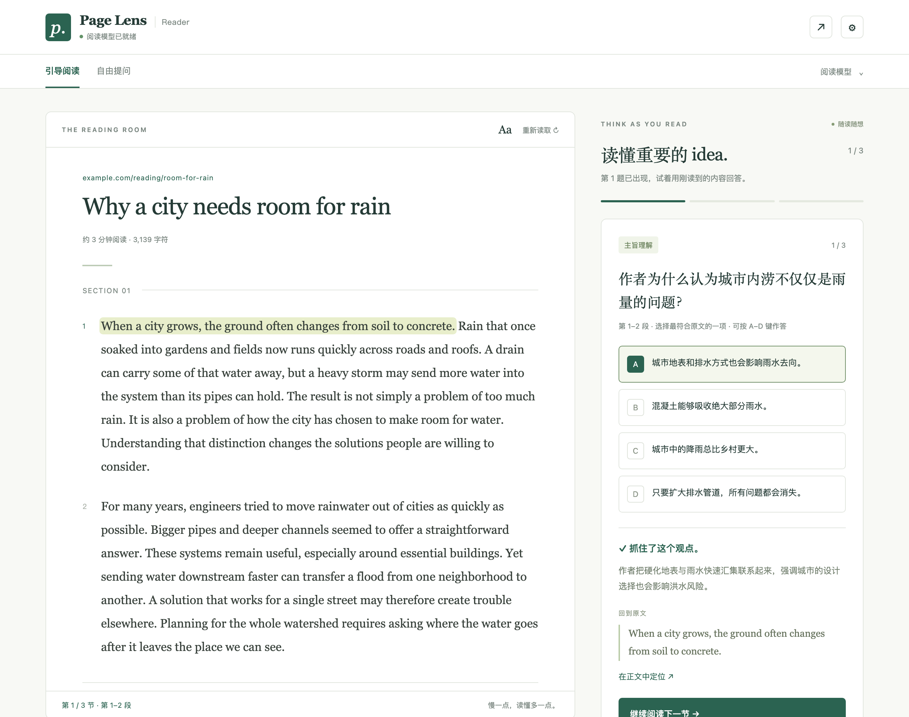
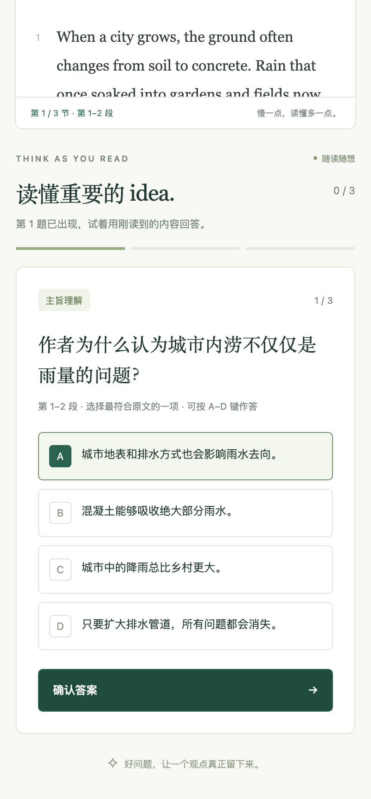
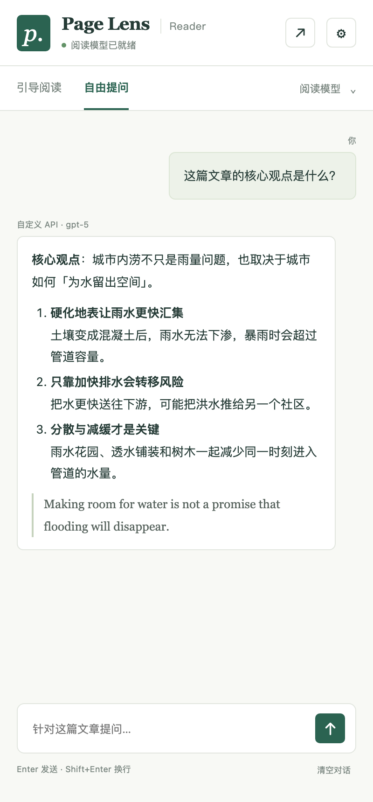

# Page Lens Reader

**把任何网页变成「边读边想」的阅读器。** 在 Chrome 侧栏里分节阅读，每读完一节回答一道理解题，答案附上原文出处，读完导出阅读笔记。支持 GPT / Kimi 订阅（经本地 CLIProxyAPI）或任意 OpenAI 兼容 API。

*A Chrome side panel that turns any article into a guided reading session: one comprehension checkpoint per section, every answer backed by a verified verbatim quote, plus article chat and selection explanations. Works with GPT/Kimi subscriptions via a local proxy or any OpenAI-compatible API.*



<p align="center">
  
  &nbsp;&nbsp;
  
</p>

## 为什么做这个

大部分「AI 侧栏」帮你**跳过**阅读：一键总结，看完就忘。Page Lens 反过来，帮你**真正读完**一篇文章：

- 读到每节末尾停一下，用一道题检查自己有没有抓住作者的观点、推理和证据；
- 每道题的答案都必须能在原文里逐字找到依据，模型编造的引用会被拒绝；
- 选错了也没关系，点一下就能回到原文那一句。

特别适合读英文长文、评论、研究导读，或者想练习阅读理解的学生和语言学习者。

## 功能

| | |
|---|---|
| **引导阅读** | 自动把文章分成 1–5 节，每节一道四选一理解题（主旨 / 因果 / 论据）。读到节末才出题，答完才解锁下一节。 |
| **原文为证** | 每个解析附带一段逐字引用，出题时就校验它确实来自这一节；「在正文中定位」精确标出那句话。 |
| **划词解释** | 在网页上选中文字后右键「用 Page Lens 解释」，或按 `Alt+Shift+E`；在阅读器里选中文字会出现「解释选中」按钮。 |
| **阅读笔记** | 读完一键导出 Markdown 笔记：题目、你的选择、解析和原文引用，可以直接放进 Obsidian / Notion。 |
| **自由提问** | 针对整篇文章追问，回答支持 Markdown 排版，随时可以停止。 |
| **进度保留** | 关掉侧栏再打开，题目和进度都还在，不会重复消耗 API；Chrome 退出时清除。 |
| **不偏 A** | 选项顺序随机打乱，避免模型总把正确答案放在第一个。 |

## 安装

1. 在 [Releases](https://github.com/okiexia-ui/page-lens/releases) 下载最新的 `page-lens-reader-v*.zip` 并解压（或直接 clone 本仓库，使用其中的 `extension` 文件夹）。
2. 打开 `chrome://extensions`，开启右上角的**开发者模式**。
3. 点击**加载已解压的扩展程序**，选择解压后的文件夹。
4. 把 **Page Lens Reader** 固定到工具栏，打开任意文章，点击图标或按 `Alt+Shift+L`。

需要 Chrome 116 或更新版本。

## 连接模型

打开侧栏右上角的 ⚙ 设置，任选一种方式：

### 方式一：自定义 API（最简单）

在 **自定义 OpenAI 兼容 API** 中填写 Base URL、API Key 和模型名称，保存后在侧栏的「阅读模型」里选择 **自定义 API**。任何实现了 `POST /chat/completions` 的服务都可以用，例如：

| 服务 | Base URL |
|---|---|
| OpenAI | `https://api.openai.com/v1` |
| DeepSeek | `https://api.deepseek.com/v1` |
| Moonshot（Kimi） | `https://api.moonshot.cn/v1` |
| OpenRouter | `https://openrouter.ai/api/v1` |

「测试并获取模型」可以列出可用模型；没有 `/models` 接口的服务也可以直接手动填写模型名。流式和非流式响应都支持。

### 方式二：GPT / Kimi 订阅（进阶）

通过本机运行的 [CLIProxyAPI](https://github.com/router-for-me/CLIProxyAPI)，把 Codex / ChatGPT 与 Kimi Code 的订阅登录转换成本地 OpenAI 兼容接口：

```text
Chrome 侧栏 -> http://127.0.0.1:8317/v1 -> CLIProxyAPI -> Codex OAuth / Kimi OAuth
```

代理只监听 `127.0.0.1`，管理接口关闭；OAuth 凭据保存在 `~/.cli-proxy-api`，扩展里只有一个本机客户端密钥。参考 [`proxy/config.example.yaml`](proxy/config.example.yaml) 配置后：

```bash
cliproxyapi -config ~/.cli-proxy-api/config.yaml -codex-login
cliproxyapi -config ~/.cli-proxy-api/config.yaml -kimi-login
```

如需开机自启，可用 [`proxy/com.local.pagelens.cliproxyapi.plist.template`](proxy/com.local.pagelens.cliproxyapi.plist.template) 生成 launchd 服务：

```bash
launchctl kickstart -k gui/$(id -u)/com.local.pagelens.cliproxyapi
```

然后在设置的「GPT / Kimi 订阅代理」中填入本机客户端密钥。也可以把 `extension/config.local.example.js` 复制为 `extension/config.local.js` 写入默认值，该文件已被 `.gitignore` 排除。使用订阅账号前请自行确认相应服务条款。

## 使用

1. 打开一篇文章，再打开侧栏，正文会立即出现在阅读器里。
2. 点击**开始引导阅读**生成问题；生成较慢时可以**取消生成**。
3. 滚动到每节末尾，问题自动出现。按 **A–D** 选择、**Enter** 确认，或直接点击。
4. 查看解析和原文引用，点**在正文中定位**回到出处，然后继续下一节。
5. 读完后可以**导出阅读笔记**、**再读一遍**，或**换一组问题**。

侧栏太窄时，点 **↗** 在新标签页打开宽屏阅读视图（原网页需保持打开）。**Aa** 切换字号，**重新读取**会重新抓取当前页面。

### 快捷键

| 快捷键 | 作用 |
|---|---|
| `Alt+Shift+L` | 打开阅读侧栏 |
| `Alt+Shift+E` | 解释网页上选中的文字 |
| `A`–`D` / `1`–`4`，`Enter` | 选择答案并提交 |

可以在 `chrome://extensions/shortcuts` 修改。

## 隐私

- 不在后台扫描网页。只有在你打开侧栏、点击「重新读取」或使用划词解释时，才读取当前页面。
- **开始引导阅读**把正文发送一次用于出题；答题、查看依据、重读和恢复进度都在本地完成。**换一组问题**和自由提问会再次发送正文。默认每页最多发送 60,000 字符，可在设置中调低以节省额度。
- 使用自定义 API 时，正文直接发送到你配置的 Base URL，请先了解该服务的隐私政策。
- 自定义 API Key 保存在 `chrome.storage.local`，不会写入仓库。生成的题目、原文引用和答题记录（最近 20 篇）只保存在 Chrome 的会话存储里，不写入磁盘，退出 Chrome 即清除。
- `chrome://` 等浏览器系统页面无法被扩展读取。

## 开发

不需要安装依赖：

```bash
npm test
```

运行语法、出题解析、Markdown 渲染、页面抓取和划词转发的检查。

```bash
npm run test:ui
```

用模拟的文章和模型响应在 Chromium 中跑完整阅读流程，不会把内容发给真实模型。需要已安装 Playwright：设置 `PLAYWRIGHT_MODULE` 指向 Playwright 模块，必要时用 `PLAYWRIGHT_CHROMIUM_EXECUTABLE` 指定浏览器。

```bash
npm run package
```

生成 `dist/page-lens-reader-v<版本>.zip`，其中的 `config.local.js` 是空文件，不会带上本机密钥。

修改代码后，在 `chrome://extensions` 的扩展卡片上点**重新加载**。

## 许可证

[MIT](LICENSE)
